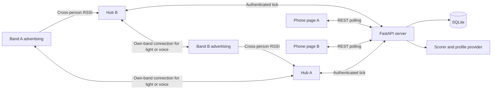
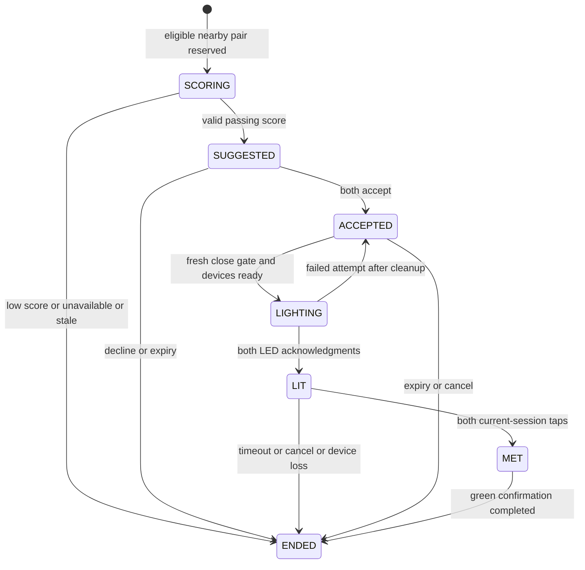

# Vexo Match final implementation plan and low level design

Vexo Match helps two nearby people discover that they are compatible and find each other using matching wristband colors. Each person registers a band, approves a profile built from app input or intentional voice notes, and explicitly enables dating discovery. A laptop hub stands in for each phone during the hackathon.

The chosen hardware path is **advertise first, connect to light later**. Test the documented reconnect window on real hardware before depending on it. If it fails, preserve the same application flow with clearly labeled simulated sightings. The firmware does not expose band-to-band scanning, and no firmware changes are included.

## 1 Final decisions and changes from the earlier plans

| Topic | Final decision |
| --- | --- |
| Discovery | Each hub listens for enrolled participants' advertising bands. Refresh its own band's advertising window through periodic connect/disconnect cycles |
| Hardware gate | Prove window renewal and repeated RSSI updates before integrating real discovery |
| Phone | Python hub plus a small local phone-style web page; real push notifications are stubbed |
| Transport | One authenticated hub poll per second, plus REST app actions. No WebSocket dependency for the demo |
| UI | Static HTML, CSS, and JavaScript served by FastAPI; React is unnecessary for this scope |
| Mutual consent | Both people accept an anonymous suggestion before public profiles are revealed and colors assigned |
| Lighting | Stable close signal triggers a bounded connected lighting session; discovery of that pair pauses |
| Separation during lighting | Not measurable through these advertisements. End via taps, cancellation, pause, connection loss, or timeout |
| Approach hints | Defer periodic color pulses: their scan gaps and connection races add complexity without proving the core loop |
| Matching | Deterministic scorer first; configurable Claude scorer second, with validated output and explicit failure behavior |
| AI profile updates | Proposed updates require user approval; voice never changes dating status or hard preferences automatically |
| Match allocation | One active match per participant, enforced by transactional reservation rows |
| SDK integration | Pin tested dependencies and kit revision. Do not copy unverified model names, SDK methods, or beta flags into the implementation |

The earlier simulated-proximity plan supplied useful lifecycle and delivery safeguards. Claude's plan supplied the real advertising experiment, simpler polling architecture, and mutual acceptance flow. This plan replaces both as the implementation specification.

## 2 Demo flow and success criteria

1. Seed two adult accounts, approved profiles, preferences, and band ownership. Start both people paused.
2. Start each authorized hub. The user double-taps their band once if necessary. Close any diagnostic dashboard holding the band connection.
3. Both people enable discovery. Their bands blink blue while advertising; each hub listens for the other participant's band.
4. Stable nearby sightings trigger mutual eligibility checks and profile scoring.
5. Both phone pages receive an anonymous suggestion with a generic compatibility explanation. No name, photo, exact profile facts, or raw transcript is disclosed yet.
6. Both accept. The server assigns a shared color and reveals the limited, approved public profiles.
7. Stable close evidence triggers a coordinated lighting attempt. Both hubs connect to their own bands and display the same solid color.
8. Each person taps their own band. Once both taps are confirmed, both bands blink green for three seconds, and the match is marked met.
9. Both hubs disconnect and return to discovery if their owners remain open. A cooldown prevents immediate rematching of the same pair.

Success means one suggestion per person, one shared match ID, one shared color, correct mutual acceptance, both device acknowledgments, and a recoverable return to discovery. An RSSI threshold is a calibrated signal condition, not a promise of one-meter accuracy.

## 3 Verified hardware contract and experiment

The repository provides diagnostic scripts; the ignored reference kit supplies the SDK and simulator. Contract facts below come from [contract.md](vexo-open-kit/contract/contract.md), especially section 1, LED rules, and disconnect behavior. [docs/api.md](vexo-open-kit/docs/api.md) describes SDK operations.

| Contract fact | Consequence |
| --- | --- |
| Idle bands do not advertise | Discovery needs an open connection window |
| Double-tap opens a 60-second window | Initial setup or recovery may require a user tap |
| Normal BLE disconnection opens a 120-second window | A controller may renew advertising without firmware changes |
| Advertising stops during the single BLE connection | Both bands disappear from discovery during connected lighting |
| Open window blinks blue | Searching is blue blinking, not an unlit band |
| Manufacturer data includes a fixed band number | Server can map enrolled numbers to accounts; identifiers are publicly trackable |
| No exposed scan command | The hub listens; the band does not discover another band |
| Link RSSI is band-to-controller | It cannot stand in for cross-person proximity when the controller follows its owner |
| Microphone activity owns the blue LED | Voice capture and match lighting need exclusive device operation |
| LED settings reset when the final transport closes | Disconnect clears custom colors unless another transport remains active |
| BLE has no pairing, bonding, or encryption | Enrollment and server authentication do not secure the radio link against another controller |

### Experiment before application integration

Obtain the actual authorized team band numbers before connecting. Store each number once in local hub configuration; verify the reported identity after every connection. Do not reuse README sample numbers.

1. Connect to the owned band, read identity, disconnect normally, and timestamp disconnection.
2. Observe advertisements for at least 125 seconds without renewing. Record whether they continue for roughly 120 seconds and stop afterward.
3. Open a new window by double-tapping, connect/disconnect, then renew at 90 seconds. Observe another complete window and repeat across three renewals.
4. Measure connection duration and verify repeated manufacturer-data and RSSI callbacks while moving the band.
5. Repeat with two authorized bands and simultaneous scanning/connection activity on the intended laptops.
6. Verify close-trigger connection, LED commands, event subscriptions, microphone exclusion, and reconnect behavior.

Renew at 90 seconds initially to leave retry margin. Schedule from the successful disconnection timestamp, not from process startup. Retry transient failures after 2 and 5 seconds; if the window is lost, report that a double-tap is needed. Do not claim an advertising duty cycle before measuring it.

Gate result: `REAL_BEACON_VERIFIED` or `SIMULATED_SIGHTINGS`. Save measured behavior and chosen calibration in a hardware validation note. Do not quietly substitute simulation for radio results.

## 4 Architecture and deployment



Use Python asyncio, FastAPI, Uvicorn, sqlite3, httpx, Pydantic, Bleak, and the existing Vexo SDK. Add the Anthropic SDK only for the Claude adapter. Reuse the kit speech integration behind a transcription adapter if available. Verify exact installed SDK and provider documentation when implementing those integrations.

Run one backend process and one serialized database write path. Each hub owns one band connection and one scanner. Two laptops, one carried by each participant, best approximate two phones. The shared server must be reachable from both: configure its host and LAN URL explicitly, restrict to the trusted demo network, and use pre-issued tokens. A server bound only to 127.0.0.1 cannot serve a second laptop.

Single-laptop mode is a staged demonstration. Its RSSI measures laptop-to-band range, not distance between two wearers. If it mirrors one reading into two hub reports, label that source `mirrored_demo`; do not count it as reciprocal real evidence. Validate that the laptop can hold two simultaneous band connections before selecting this mode.

## 5 Components and ownership

| Component | Owns |
| --- | --- |
| API | Authentication, validation, app actions, hub ticks, public response projection |
| Presence service | Directed observations, source sessions, freshness, smoothing outputs and stable zones |
| Matcher | Eligibility, candidate ranking, scoring jobs, versioned score cache |
| Lifecycle service | All match transitions, member reservations, color leases, cancellation |
| Background worker | Expiry, stale hubs, scoring recovery, delivery reconciliation even when no client polls |
| Hub scanner | Passive advertisement observations and manufacturer-data parsing |
| Hub BandLink | Single connection owner, serialized commands, advertising renewal, light and voice modes |
| Device coordinator | Desired command version, lease expiry, acknowledgment tracking |
| Notification inbox | Durable per-user items; polling delivery is idempotent |
| Profiler | Transcript-to-proposal extraction and approval workflow |

A request handler never calls BLE. Scoring provider requests run outside database transactions. The server stores desired device state; hubs reconcile toward it on each tick.

## 6 Data model and invariants

Use UUID application IDs, UTC timestamps, foreign keys, validated enum values, and migrations. Canonical pair keys use `user_low < user_high`. A band number is not an authentication credential.

| Table | Fields and important constraints |
| --- | --- |
| `users` | `id`, `display_name`, `date_of_birth`, explicit `gender`, `dating_status`, `status_version`; default paused |
| `preferences` | `user_id PK`, accepted genders, mutual age limits, explicit relationship-goal dealbreakers, `version` |
| `bands` | `id`, `number UNIQUE`, `user_id UNIQUE`, assigned `hub_id`; range 1–999 |
| `profiles` | `user_id PK`, `version`, approved summary, interests, values, relationship goal |
| `voice_notes` | `id`, `user_id`, transcript, source, created/deleted timestamps; no public transcript access |
| `profile_proposals` | `id`, `user_id`, `base_version`, structured changes, approval state |
| `hub_sessions` | `id`, `hub_id`, authenticated user/device mapping, last tick, connection/microphone/battery state |
| `sightings` | directed `(observer_id, target_band_id) PK`, source session, sequence, RSSI, sample count, first/last sample timestamps, source, stable zone |
| `score_jobs` | pair, both profile/preference versions, scorer version, state, result, lease deadline, retry count; unique cache key |
| `matches` | `id`, pair, state, score, private reasons, profile versions, acceptance flags, color, version, deadlines, end reason |
| `active_members` | `user_id PK`, `match_id`; enforces one active match per user |
| `color_leases` | `color_hex PK`, `match_id UNIQUE`, release-after timestamp |
| `pair_cooldowns` | canonical pair PK, reason, expiry |
| `blocks` | directed blocker/blocked composite key |
| `notifications` | `id`, recipient, match, kind, safe payload, read state; unique `(recipient, match, kind)` |
| `device_desired` | `band_id PK`, monotonic version, command ID, match ID, mode, color, lease, expiry |
| `device_acks` | command ID and device unique key, status, applied time, error |

Do not make the pair permanently unique in `matches`: the same people may meet again after cooldown. Preserve historical attempts and cache scores by profile and scorer versions. Reserve both member rows atomically before starting scoring; release them on failed eligibility, below-threshold verdict, job failure, or terminal match state.

Color reservations remain quarantined through device cleanup acknowledgment or lease expiry. Releasing a match slot does not immediately make a possibly still-lit color reusable.

## 7 Proximity processing

A sighting means “observer hub heard target band,” not “band A heard band B.” Ignore the hub's own band. Accept only enrolled demo participants; never connect to a detected counterpart. Existing kit instructions restrict scans to team devices; the experiment must use an explicitly authorized demo roster and limit scan filters to that roster. Open-ended public scanning is a later product change.

```json
{
  "target_band_number": 123,
  "source": "real_beacon",
  "sequence": 42,
  "rssi_dbm": -61,
  "samples": 8,
  "window_seconds": 5,
  "sample_age_ms": 150
}
```

The number above illustrates a payload, not a device to connect to. Resolve all actual device numbers from enrollment configuration.

Use a five-second rolling median followed by EMA with alpha 0.3, updated once per second. Require three fresh samples before classifying. Clear the filter after a stale gap. Initial thresholds are calibration guesses:

| Transition | Initial condition |
| --- | --- |
| FAR to NEAR | Smoothed RSSI at least −78 dBm for three seconds |
| NEAR to FAR | Below −84 dBm for five seconds |
| NEAR to CLOSE | At least −58 dBm for three seconds |
| CLOSE to NEAR | Below −66 dBm for five seconds |
| Any measured zone to UNKNOWN | No fresh sample for eight seconds |

At least one real direction must show stable near to start evaluation, with both hubs alive and both own bands ready. For the two-hub real demo, require both directions to show fresh stable close within the last five seconds before lighting. If reciprocal evidence is unreliable, use an explicitly labeled operator confirmation rather than silently weakening the rule. Single-laptop and simulated modes use their own labeled gate.

Server receipt time bounds freshness. Reject replayed sequence values and impossible sample ages; repeated ticks containing an unchanged observation do not refresh its original sample time. The server validates thresholds and dwell from timestamped reports instead of trusting a client-supplied zone. Keep signal evidence separate from subsequent lighting state.

When LIGHTING begins, latch the fact that close was observed and timestamp it. Missing advertisements during LIGHTING and LIT are expected. Do not pretend the zone remains measured close. The UI says “Proximity last confirmed before lighting.” Hub heartbeats must remain fresh throughout.

## 8 Eligibility and scoring

Apply hard filters before calling a scorer:

- Distinct adult users; both explicitly open; approved complete profiles.
- Both people's explicit age, gender, and relationship-goal dealbreakers satisfied.
- No block in either direction or active pair cooldown.
- Fresh nearby evidence, live hubs, and no conflicting active match.
- Neither band in a voice session or unavailable for discovery.

First implement a deterministic scorer using normalized interest/value tags:

```text
score = round(100 * (0.40 * interests_jaccard
                   + 0.35 * values_jaccard
                   + 0.25 * explicit_goal_compatibility))
```

Empty tag unions score zero. Require at least three interests, two values, and a relationship goal. Goal compatibility is 1 for identical goals, 0.5 for explicitly mutually accepted different goals, otherwise 0. Use a configurable threshold of 60 for this heuristic.

The Claude adapter returns schema-validated `score` (0–100), evidence-backed shared tags, private explanation, and an icebreaker. Start with threshold 70 for that adapter; its scale is independent of the deterministic score. This is a demo heuristic, not a probability of romantic success. Keep model ID and scorer version in configuration. Verify the available model and structured-output API during implementation; do not use the model identifier or fallback flags copied from Claude's draft without verification.

Send approved profile fields only, without names, IDs, raw transcripts, identity or age fields already handled by eligibility. Treat profile text as untrusted data and disallow prompt instructions inside it. Validate returned evidence against actual approved fields. A refusal, malformed result, or timeout yields `SCORING_UNAVAILABLE`, not “incompatible.” Allow one retry within a 15-second total budget. Deterministic fallback is permitted only when configured and visibly labeled.

Cache both negative and positive results for 24 hours keyed by both profile versions, both preference versions, scorer configuration, and prompt version. Revalidate eligibility after the asynchronous result returns before creating notifications. Discard stale results.

### Concurrency algorithm

```text
on periodic matching evaluation:
  rank eligible nearby candidates by signal freshness, then canonical pair ID
  BEGIN IMMEDIATE
    re-read eligibility and availability
    create SCORING match and reserve both active_members rows
    create/reuse versioned scoring job
  COMMIT

outside transaction: obtain scoring result

  BEGIN IMMEDIATE
    verify job ownership, current match state, eligibility and versions
    if stale, below threshold, or unavailable: terminate and release members
    otherwise: set SUGGESTED and insert one notification per recipient
  COMMIT
```

No network request occurs in either transaction. Database uniqueness conflicts roll back both reservations. Job leases and a periodic worker recover interrupted scoring after a restart. Scoring reservations expire after 20 seconds. This deliberately favors simple, deterministic allocation over global optimal matching.

## 9 Match lifecycle and deadlines



The first acceptance stays in SUGGESTED with one acceptance flag. All state transitions are implemented in one lifecycle module. Pause, block, profile/preference changes, hub loss, and device failure can end any applicable active state. Profile changes invalidate previous acceptance and require a new evaluation.

| Timer or condition | Default behavior |
| --- | --- |
| Suggestion response deadline | Two minutes to accept; no response ends it |
| Accepted approach deadline | Three minutes to reach close |
| Lighting attempt deadline | Ten seconds for both connections and LED acknowledgments |
| Retry after partial lighting | At most two attempts; require cleanup and fresh close evidence before retry |
| Lit session | At most 60 seconds; no separation claim during this interval |
| Hub heartbeat lost | Five seconds; request cleanup and end affected match |
| Green met confirmation | Three seconds, then disconnect |
| Pair cooldown | Ten minutes after decline/cancel/met; one minute after expiry or device failure |
| Below-threshold cache | 24 hours, invalidated by profile/preference/scorer version changes |

Accept/decline/tap/cancel actions are idempotent and authorized against match membership. Record taps only after that band applied the current lighting command and subscribed to events. A tap carries match ID, lighting-session ID, and a unique event ID; debounce repeats locally and deduplicate on the server. Both taps must belong to the same live session. App confirmation is a labeled fallback if event hardware fails.

## 10 Device coordination and failure behavior

Each hub has one BandLink actor with a serialized command queue. Its modes are `BEACON`, `PREPARING_LIGHT`, `LIT`, `MET_FLASH`, `VOICE`, and `RECOVERY`. A mode change cancels an old renewal timer; a renewal cannot disconnect an active lighting or voice session.

```python
class BandAdapter:
    async def connect(self, configured_owned_number: int): ...
    async def set_led(self, color, pattern, brightness, period): ...
    async def enable_taps(self, handler): ...
    async def led_off(self): ...
    async def disconnect(self): ...
```

Implement real and simulated adapters. The simulator's `set_rssi` affects its own link stream: it does not broadcast a real BLE advertisement or generate cross-person discovery. A separate simulated-sighting adapter injects pair observations.

The server atomically allocates a color and issues desired states for both bands. Palette: teal, pink, orange, purple, yellow, white. Reserve blue for device/microphone status and green for met confirmation. Allocate globally unique active colors for the small demo; palette exhaustion leaves the match accepted and waiting.

```json
{
  "command_id": "uuid",
  "desired_version": 12,
  "match_id": "uuid",
  "lighting_session_id": "uuid",
  "mode": "LIT",
  "color": "#00c7be",
  "pattern": "solid",
  "brightness": 0.6,
  "valid_for_ms": 5000
}
```

The heartbeat renews a five-second local command lease; hubs enforce it using a monotonic clock. A command applies only if newer than the last accepted version and still valid. The hub acknowledges APPLIED, FAILED, EXPIRED, or SUPERSEDED. Only two current APPLIED acknowledgments transition the match to LIT; until then show “Preparing bands.” An SDK acknowledgment confirms acceptance, not optical brightness or exact synchronization.

On partial success, send a newer off/disconnect command to both. Return to BEACON only if the owner remains open, then reacquire close observations before retrying. Do not reuse the color until both cleanup acknowledgments arrive or all outstanding leases have expired. Failed cleanup remains visible to the operator.

If server communication stops, each surviving hub clears custom LEDs and disconnects on lease expiry. On reconnect, it fetches current desired state rather than replaying queued colors. Disable automatic lighting restoration unless a current server lease explicitly permits it. A total hub-process crash has no guaranteed application watchdog in band firmware; verify actual disconnect cleanup and document the residual risk.

Pausing dating disconnects without renewing future discovery windows. The firmware may continue advertising and blue blinking for the remaining window; the server must immediately exclude the person from matching regardless. Show that discovery is disabled in the app rather than promising instant radio invisibility.

## 11 API and polling protocol

Use opaque pre-issued user, hub, and operator tokens in demo mode; derive identity from the token rather than a path or body user ID. Hub tokens bind to one configured band. Participant clients cannot claim arbitrary bands or inject sightings for another observer.

| Route | Purpose |
| --- | --- |
| `GET /api/me` | Own approved profile, preferences, status, hub summary |
| `PATCH /api/me/profile` | Explicit edits with expected profile version |
| `PATCH /api/me/preferences` | Mutual matching constraints with expected version |
| `PUT /api/me/dating-status` | Open/pause with version guard; pause cancels active match transactionally |
| `POST /api/hub/tick` | Own health, fresh directed observations, pending tap events and acknowledgments; returns desired state |
| `GET /api/me/match` | Current anonymous suggestion or accepted public counterpart profile |
| `POST /api/matches/{id}/respond` | Accept/decline; recheck membership and lifecycle version |
| `POST /api/matches/{id}/cancel` | Cancel own active match |
| `POST /api/users/{id}/block` | Block counterpart and cancel affected match |
| `GET /api/me/notifications?after={cursor}` | Durable phone-stub inbox updates |
| `POST /api/notifications/{id}/read` | Caller-owned read acknowledgment |
| `POST /api/me/voice-notes` | Typed transcript or completed hub capture metadata |
| `POST /api/me/voice-sessions` | Request intentional capture through own hub |
| `POST /api/me/voice-sessions/{id}/stop` | Stop capture |
| `GET /api/me/profile-proposals` | Pending AI-proposed changes |
| `POST /api/me/profile-proposals/{id}/accept` | Apply only against unchanged base version |
| `POST /api/demo/sightings` | Operator-only simulated or mirrored evidence |
| `POST /api/demo/reset` | Operator-only clean demo reset after device cleanup |

Tick request includes source-session ID, monotonic request sequence, observation ages, own-band connection/mic/battery status, and acknowledgment/tap arrays. Tick response includes server time, accepted sequence, desired state/version, event acknowledgment IDs, and next poll delay. Retain unacknowledged tap events and device acknowledgments across transient request failures. Duplicate ticks must not create duplicate side effects.

Poll at one second, back off on network errors, and cap request duration. A separate 500 ms lifecycle worker handles deadlines even when everyone stops polling. Phone pages poll current match and inbox once per second, deduplicate notification IDs, and refresh authoritative state after reconnect. All public profile projections are enforced server-side.

## 12 Voice and profile learning

Keep the core demo usable with approved seeded profiles. Add intentional 30-second voice capture only after matching and device behavior work.

1. User starts a check-in while paused or without an active match. If a match exists, require ending it first; do not silently take the band away.
2. Hub suspends renewal, connects, starts microphone capture, and shows recording status. Firmware supplies the blue indicator.
3. Transcribe through the kit-backed provider adapter. A missing key or provider failure offers typed notes and leaves the approved profile unchanged.
4. Extract summary, interests, values, and explicit relationship goal into a schema-validated proposal using up to the latest 20 intentional notes.
5. User reviews proposed changes and accepts or rejects. Acceptance uses an optimistic profile-version check.
6. Stop all microphone streams and disconnect in a finally block; resume advertising renewal only if open.

Do not infer age, gender, dating consent, hard preferences, or personality diagnoses from voice. Do not retain raw audio by default after transcription. Keep transcripts private and deletable. Provider keys remain server-side or in local ignored configuration; never embed them in the phone page.

## 13 File layout and configuration

```text
IMPLEMENTATION_PLAN.md
README.md
setup.sh                    existing diagnostic workflow
detect.py                   existing diagnostic tool
server/
  app.py                    routes and static UI
  config.py
  db.py                     migrations and transactional repositories
  eligibility.py
  matcher.py                scoring adapters and cache
  lifecycle.py              transitions, reservations, timers, color leases
  worker.py                 periodic expiry and scoring jobs
  profiler.py
  schemas.py
hub/
  hub.py                    entry point and task supervision
  band_link.py              single connection actor and modes
  scanner.py                roster-scoped advertisement parsing
  proximity.py              filtering and timestamped observations
  client.py                 authenticated polling and acknowledgments
  voice.py
  adapters.py               real and simulated bands
ui/
  phone.html
  phone.js
  styles.css
  operator.html
config/
  demo.example.json         no secrets or guessed device identities
demo/
  seed.py
  beacon_check.py
  run_demo.sh
  simulated_sightings.py
tests/
  test_eligibility.py
  test_presence.py
  test_allocation.py
  test_lifecycle.py
  test_delivery.py
  test_api_authorization.py
vexo-open-kit/              ignored existing reference kit
```

Configuration covers server URL, bound address, demo mode, authorized band roster, hub identity, token references, scorer provider/model/threshold, RSSI calibration, deadlines, and kit revision. Ignore databases, recordings, secrets, and per-device local configuration. Pin dependencies for repeatable setup and separate application startup from the existing auto-updating diagnostic setup path.

## 14 Build order and acceptance gates

| Phase | Deliverable | Exit check |
| --- | --- | --- |
| 0 Hardware feasibility | Beacon experiment and calibration note | Renewal, scan callbacks, LED and tap behavior measured on authorized bands; fallback chosen explicitly |
| 1 Backend foundation | SQLite migrations, sessions, enrollment, profiles, preferences, open/pause | Two sessions remain isolated; unauthorized device and profile access rejected |
| 2 Matching with fake sightings | Eligibility, deterministic scoring, reservations, match state machine, periodic worker | Compatible nearby pair gets exactly one shared suggestion; paused/ineligible pair gets none |
| 3 Phone stub and acceptance | Phone pages, inbox polling, anonymous suggestion, accept/decline | Profile revealed only after both accept; notification survives refresh |
| 4 Device simulator | Desired versions, acknowledgments, leases, palette, tap-to-met | Full flow plus injected failures works without BLE |
| 5 Real hub integration | Beacon renewal, roster scanner, calibration, real lighting and events | Two real bands discover, match, light, confirm met, and resume discovery |
| 6 Claude matching | Provider adapter, structured validation, versioned cache | Good, poor, timeout, malformed, and stale-result cases handled; no hard-filter bypass |
| 7 Profile learning | Seed-note proposals, approval, optional band voice recording | Accepted proposal changes future matching; rejected/stale proposal does not |
| 8 Demo rehearsal | Charged bands, two hubs, clean reset and documented fallback | Repeat full sequence three times plus one pause and one device-failure case |

Phases 0–5 prove the central hardware experience. Phases 6–7 add AI profile learning and analysis. Timebox phase 0 to roughly one hour; if it fails, continue with simulated sightings rather than rewriting firmware. Other estimates depend on that outcome and available hardware; avoid a fixed promise based on untested radio behavior.

## 15 Required verification

Use a fake clock, temporary SQLite database, and simulated device/provider adapters. Test the invariants and race conditions rather than mirroring implementation details.

| Scenario | Required outcome |
| --- | --- |
| Either paused, blocked, underage, or outside mutual preferences | No match and no counterpart profile exposure |
| Duplicate ticks or both hubs report concurrently | One active match and one suggestion notification per recipient |
| Three compatible people nearby | Atomic one-match-per-user reservation; losing candidate remains available |
| Provider returns after pause, block, or profile change | Result discarded; no stale notification |
| One acceptance only | No counterpart profile and no color command |
| Noisy RSSI and stale repeated observations | Dwell/hysteresis respected; replayed ticks do not refresh presence |
| Both accept but only one real close direction | No automatic real-mode lighting; labeled operator fallback available |
| Both bands connect for lighting and stop advertising | Lighting session continues with last-confirmed evidence; no false separation event |
| First band lights and second fails | No “both lit” claim; cleanup, color quarantine, fresh evidence before retry |
| Pause races with old LED command or acknowledgment | Newer desired state wins; stale acknowledgment cannot restore a match |
| Server lost while lit | Surviving hubs clear LEDs by local lease expiry |
| Hub process dies | Mark unavailable, clean up other side, document real band's observed disconnect behavior |
| No further client ticks | Background worker still expires matches and frees reservations |
| One band records voice | No matching-light operation steals its microphone session |
| Repeated tap or late tap from an old session | Idempotent; cannot mark a new match met |
| Palette exhausted | Wait without reusing a possibly lit color |
| All modes on one laptop | Clearly identify simulated/mirrored evidence and actual distance being measured |

Log transition reasons, match/job/command IDs, profile/scorer versions, timing, and device failures. Exclude credentials, private transcripts, and full profiles. Hardware targets after dwell: suggestion within two seconds with the deterministic scorer, lighting within ten seconds after close, and clear app status for all failures. Measure rather than assume these targets.

## 16 Later product work

Production discovery needs a separately validated phone or firmware channel with rotating identifiers, operating-system background testing, and continuous proximity during lighting. Standard phone apps must not assume they have the privileged capabilities of Find My or exposure-notification systems.

Add real authentication and verified device enrollment, radio security, push delivery, reporting, richer privacy controls, operational observability, and retention controls before public deployment. Static band numbers are trackable even when names stay private. This hackathon plan changes application behavior only and does not remove firmware or radio limitations.

## 17 Inputs needed before hardware implementation

Confirm the actual owned band numbers, number of real bands, one-laptop versus two-laptop topology, and available provider keys. These inputs do not block building the server, UI, or simulated adapters. They do block connecting to hardware or claiming real proximity validation.
